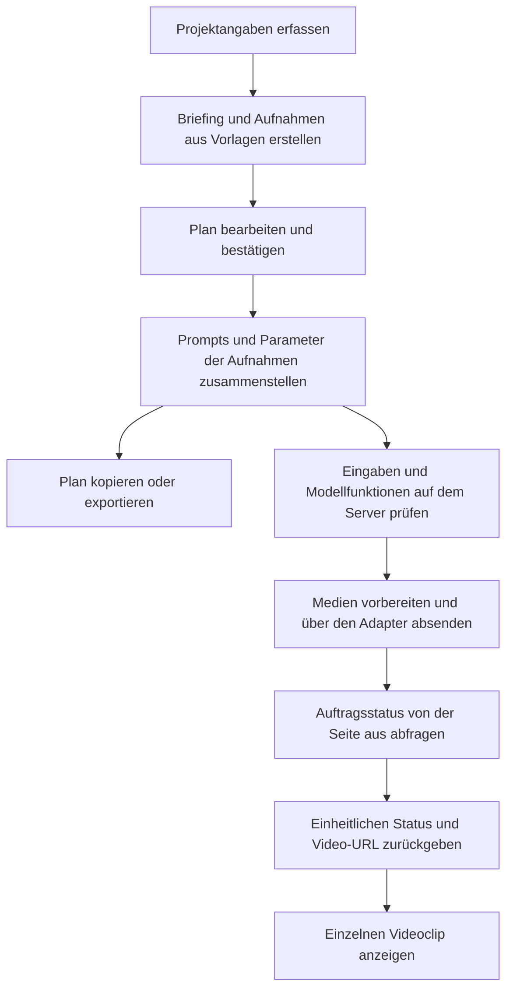

# AI Rap Video Generator — Von der kreativen Idee zum Workflow für die Videogenerierung

[English](README.md) · [简体中文](README.zh-CN.md) · **Deutsch** · [Français](README.fr.md) · [Español](README.es.md)

## Überblick

**Ein Referenzprojekt zur Entwicklung von KI-Generatoren für Rap-Videos. Es umfasst die Planung einzelner Aufnahmen, die Prompt-Erstellung und die Anbindung einer Video-API.**

Das Repository basiert auf **TypeScript, Next.js und CSS Modules**. Es enthält eine interaktive Arbeitsoberfläche, vorlagenbasierte Aufnahmeplanung, einen Prompt-Builder, die Verwaltung von Generierungsaufträgen und Exportfunktionen. Die Anbindung der Video-API erfolgt über einen separaten Adapter, den Entwickler für den gewählten Dienst implementieren.

**Demo: [AI Rap Video Generator](https://getairapvideos.com/)**

Die Demo zeigt das Produkterlebnis. Dieses Repository enthält ein separates Implementierungsbeispiel.

### Wofür sich der Quellcode nutzen lässt

- **Den Aufbau einer KI-Videoanwendung verstehen:** Den Weg von den Nutzereingaben über die Aufnahmeplanung und Prompt-Erstellung bis zur Generierungsanfrage nachvollziehen.
- **Eine eigene Anwendung entwickeln:** Auf der kreativen Oberfläche und dem Workflow aufbauen und den Adapter für die gewählte Video-API implementieren.
- **Einzelne Module wiederverwenden:** Vorlagen für Aufnahmen, Prompt-Erstellung, Auftragsverwaltung oder Exportlogik in ein anderes Projekt übernehmen.
- **Andere Videoformate erkunden:** Visuelle Vorlagen, Abfolgen von Aufnahmen und Prompts an andere Themen oder Stile anpassen.

Die kreative Planung verwendet Vorlagen und Regeln und benötigt daher keine zusätzliche Sprachmodell-API. Ohne Video-API lassen sich die Beschreibungen der geplanten Aufnahmen bearbeiten, Prompts prüfen, lokale Medien ansehen und Pläne exportieren. Nach der Anbindung kann für jede Aufnahme ein Videoclip generiert werden.

## Durchgängiges Beispiel

Das folgende Beispiel für ein 15-sekündiges Rap-Video zeigt, wie Daten durch die Anwendung fließen.

### 1. Projektangaben erfassen

Der Nutzer gibt ein Thema, optional einen Liedtext und eine Beschreibung der auftretenden Person an. Dazu kommen Bildstil, Seitenverhältnis, Dauer und Intensität des Auftritts. Die Oberfläche speichert diese Angaben als `CreativeConfig`:

```ts
import type { CreativeConfig } from './src/lib/types';

const config: CreativeConfig = {
  theme: 'An independent rapper steps into the light in a parking garage on a rainy night, moving from being overlooked to finding their voice.',
  lyrics: 'From the underground into the light, tonight I let my voice take flight.',
  performer: 'One independent rapper, with a consistent face and hairstyle across all shots.',
  styleId: 'night-street',
  aspectRatio: '9:16',
  durationSeconds: 15,
  energy: 'confident',
};
```

Das Thema beschreibt die kreative Absicht. Die übrigen Felder liefern die visuellen Vorgaben und Zeitangaben für Planung und Generierung.

### 2. Bildgestaltung und Vorlagen für Aufnahmen kombinieren

[`templates.ts`](src/lib/templates.ts) definiert drei Bildstile – verregnete Straßen, eine minimalistische Bühne und Comic-Animation – sowie unterschiedliche Intensitäten für den Auftritt. Die Vorlage für verregnete Straßen liefert diese gemeinsamen Vorgaben:

| Vorgabe | Beschreibung |
| --- | --- |
| Kleidung | Schwarze Jacke und silberne Kette |
| Ort | Tiefgarage bei Nacht mit nassem Betonboden |
| Licht | Kühles blaues Umgebungslicht und warmes Kantenlicht |
| Bildstil | Filmischer Realismus, natürliche Hautstruktur und eine deutlich vom Hintergrund abgehobene Person |

[`planner.ts`](src/lib/planner.ts) verbindet diese Vorgaben mit den Nutzereingaben zu einem kreativen Briefing und wählt anhand der gewünschten Dauer Vorlagen für Aufnahmen aus. Ein Plan für 15 Sekunden beginnt mit drei Aufnahmen:

| Aufnahme | Zeit | Aktion | Bildausschnitt und Kamerabewegung |
| --- | --- | --- | --- |
| Person einführen | 0–5 Sekunden | Den Kopf aus dem Schatten heben und zur Kamera blicken | Ruhige frontale Aufnahme ab der Taille |
| Auftritt beginnen | 5–10 Sekunden | Sich mit natürlichen, selbstbewussten Gesten an die Kamera wenden | Langsame Annäherung von der Taille bis zum Brustbereich |
| Schlussbild halten | 10–15 Sekunden | In einen helleren Bereich treten und den Blick auf die Kamera gerichtet halten | Ruhiger Bildausschnitt ab der Brust |

Die Auswahl folgt vordefinierten Regeln. Thema und Liedtext bleiben kreativer Kontext; das Planungsmodul erfindet keine Handlung durch semantische Analyse. Pläne für 30 und 45 Sekunden beginnen mit sechs beziehungsweise neun Aufnahmen.

### 3. Den Plan bearbeiten und Anfragen erstellen

Im Frontend lassen sich das Briefing sowie Aktion, Kameraführung und Dauer jeder Aufnahme bearbeiten. Änderungen an gemeinsamen Vorgaben aktualisieren sämtliche Prompts; eine geänderte Aktion betrifft nur die jeweilige Aufnahme. Zeitleiste und Gesamtdauer werden aus den Daten der Aufnahmen neu berechnet.

[`prompt-builder.ts`](src/lib/prompt-builder.ts) erzeugt anschließend zwei Ausgaben:

- **Einen Text-Prompt:** Er beschreibt Person, Umgebung, Aktion und Bildstil für das Modell.
- **Eine strukturierte Anfrage:** Sie enthält Seitenverhältnis, Dauer, Angaben zur Verwendung von Bild- und Audioreferenzen sowie den Audiostartpunkt für den Videoadapter.

Dieser Datenfluss verbindet die kreative Oberfläche mit dem Videodienst. Vorlagen, Prompts und Anbieteranbindung bleiben getrennt, sodass sie unabhängig voneinander geändert werden können.

## Prompt-Design

### Gemeinsame Vorgaben von einzelnen Regieanweisungen trennen

Ein Prompt ist die Textanweisung an ein Modell. Dieses Projekt setzt ihn aus folgenden Abschnitten zusammen:

| Abschnitt | Quelle | Zweck |
| --- | --- | --- |
| Kreativer Kontext | Thema und emotionale Richtung | Die Aussage des Videos vermitteln |
| Person, Kleidung, Umgebung und Licht | Kreatives Briefing | Gemeinsame visuelle Anforderungen festlegen |
| Auftritt und Kamera | Aktuelle Aufnahme und Intensität | Beschreiben, was in dieser Aufnahme geschieht |
| Liedtext als Kontext | Vom Nutzer eingegebener Text | Den Originalwortlaut als kreative Referenz erhalten |
| Medienreferenzen | Ausgewählte Dateien und Modellfunktionen | Bei Bedarf Porträt- oder Audioanweisungen ergänzen |
| Einschränkungen | Gemeinsame Regeln | Eine durchgehende Aufnahme ohne zusätzliche Personen oder Untertitel anfordern |

Diese Struktur erleichtert Anpassungen am gesamten Bildkonzept und an einzelnen Aufnahmen. Die Anweisungen beschreiben das gewünschte Ergebnis; ein gleichbleibendes Aussehen der Person und die Qualität der Lippensynchronisation hängen weiterhin vom gewählten Modell ab.

<details>
<summary>Vollständigen Prompt für die Performance-Aufnahme mit Porträtreferenz ansehen (Englisch)</summary>

```text
Create one continuous shot for a rap music video.

CREATIVE CONTEXT
An independent rapper finds the confidence to be heard.
Emotional direction: from restraint to confidence.

CHARACTER
One independent rapper, with a consistent face and hairstyle.
Use the supplied portrait as the identity reference.
Preserve the facial features and hairstyle.
Wardrobe: black jacket and a simple silver chain.

SETTING
An underground parking garage at night, with wet concrete
and open space around the performer.

LIGHTING
Cool blue overhead light with a subtle warm rim light.

PERFORMANCE
Face the camera with natural upper-body gestures.
Keep the face clearly visible and maintain confident eye contact.

CAMERA
Slowly push from a waist-up framing to a chest-up framing
in one continuous movement.

VISUAL STYLE
Cinematic realism, natural skin texture, restrained contrast
and clear subject separation.

CONSTRAINTS
One continuous shot. No additional performers.
No outfit changes. No captions, logos or watermarks.
```

</details>

### Zeitangaben und Medien als Modellparameter übergeben

Seitenverhältnis, Zieldauer und Audiostartpunkt werden über `ShotRequest` übergeben. Prompt-Text ersetzt keine API-Parameter. Ohne Porträt verwendet der Prompt eine Textbeschreibung. Audioanweisungen werden nur ergänzt, wenn der Nutzer eine Audiodatei bereitstellt und der konfigurierte Adapter angibt, dass das Modell eine audiogesteuerte Performance unterstützt.

Porträts und Audiodateien lassen sich lokal im Browser ansehen beziehungsweise abspielen. Beim Absenden einer Generierungsanfrage bereitet der serverseitige Adapter die Medien vor. Der Audiostartpunkt ergibt sich aus dem vom Nutzer gewählten Startpunkt plus der Position der Aufnahme auf der Zeitleiste. Der Adapter muss den passenden Audioabschnitt zuschneiden oder die Zeitangaben den Parametern des Anbieters zuordnen.

[`export.ts`](src/lib/export.ts) exportiert das Briefing, die Beschreibungen der Aufnahmen und die Prompts als Markdown oder den Plan samt internen Anfragedaten als JSON. Exporte enthalten Dateinamen, aber nicht die Mediendateien selbst.

## Generierungsworkflow

Das Frontend erfasst und zeigt die kreativen Daten; der Server kommuniziert mit dem Videoanbieter. Durch die Trennung von Planung und Generierung können Entwickler den Anbieter wechseln, ohne den Editor für einzelne Aufnahmen neu zu schreiben.



### Generierung je Aufnahme verwalten

Jede Aufnahme erhält eine Anfrage-ID, einen Konfigurationsfingerabdruck, einen Auftragsstatus und ein Ergebnis. Der Arbeitsbereich verarbeitet jeweils einen Generierungsauftrag und sperrt währenddessen die kreativen Vorgaben. So bleibt die übermittelte Konfiguration ihrem Ergebnis zugeordnet.

Der Konfigurationsfingerabdruck kennzeichnet die Version, zu der ein Ergebnis gehört. Wird eine abgeschlossene Aufnahme geändert, markiert die Oberfläche das vorherige Video als älteres Ergebnis und ermöglicht eine erneute Generierung.

### Fehlgeschlagene Aufträge von Netzwerkproblemen unterscheiden

| Situation | Verhalten des Workflows |
| --- | --- |
| Der Anbieter lehnt eine Anfrage ausdrücklich ab oder meldet eine fehlgeschlagene Generierung | Einen neuen Versuch für diese Aufnahme erlauben |
| Eine Übermittlung liefert kein eindeutiges Ergebnis | Anfrage-ID behalten und den bestehenden Auftrag suchen, ohne ihn automatisch erneut abzusenden |
| Eine Statusabfrage schlägt vorübergehend fehl | Den zuletzt bekannten Status beibehalten und weiter abfragen |
| Die Generierung ist erfolgreich | Die zurückgegebene Video-URL anzeigen |

Diese Unterscheidung verhindert, dass ein Timeout als Beweis für einen Fehlschlag gilt und dadurch eine Anfrage doppelt abgeschickt wird. Um einen Auftrag nach dem Verlust der Übermittlungsantwort wiederzufinden, muss der Adapter die Suche des Anbieters nutzen oder eine Zuordnung von Anfrage-IDs zu Auftrags-IDs speichern.

Textentwürfe werden im lokalen Browserspeicher abgelegt; Medien und Auftragsstatus bleiben in der aktuellen Seitensitzung. Das Projekt enthält keine Datenbank, keine Warteschlange für Hintergrundaufträge, keine Zusammenführung der Videoclips und keine Audiomischung. Bei Bedarf lassen sich Module zur dauerhaften Auftragsspeicherung und Mediennachbearbeitung ergänzen.

## Architektur und API-Anbindung

### Lokal starten

Node.js 22 oder neuer verwenden. Im Projektverzeichnis ausführen:

```bash
npm install
cp .env.example .env.local
npm run dev
```

Den [lokalen Arbeitsbereich](http://localhost:3000) öffnen. Unter Windows lässt sich `.env.example` manuell nach `.env.local` kopieren. Bleiben die Umgebungsvariablen leer, ist die Videogenerierung deaktiviert; die kreativen Werkzeuge stehen weiterhin zur Verfügung.

### Orientierung im Quellcode

| Modul | Datei | Aufgabe |
| --- | --- | --- |
| Kreative Oberfläche | [studio.tsx](src/components/studio.tsx) | Eingaben, Editoren, Prompts und Videoergebnisse verbinden |
| Datentypen | [types.ts](src/lib/types.ts) | Kreative Konfigurationen, Aufnahmen, Anfragen und Aufträge definieren |
| Vorlagen und Planung | [templates.ts](src/lib/templates.ts), [planner.ts](src/lib/planner.ts) | Briefing und Abfolge der Aufnahmen erstellen |
| Prompt-Erstellung | [prompt-builder.ts](src/lib/prompt-builder.ts) | Anweisungen kombinieren und interne Anfrageparameter erzeugen |
| Generierungsaufträge | [workflow.ts](src/lib/workflow.ts), [use-video-workflow.ts](src/components/use-video-workflow.ts) | Absenden, Abfragen, Wiederherstellen und den Frontend-Status verwalten |
| Videoadapter | [custom.ts](src/lib/providers/custom.ts) | Die für den gewählten Anbieter zu implementierenden Methoden definieren |
| Server-Endpunkt | [jobs/route.ts](src/app/api/video/jobs/route.ts) | Eingaben prüfen, den Adapter aufrufen und Antworten vereinheitlichen |
| Planexport | [export.ts](src/lib/export.ts) | Markdown- und JSON-Dateien erzeugen |

### Eine eigene Video-API anbinden

Anbieterspezifischer Code gehört in `src/lib/providers/custom.ts`. Diese vier Methoden müssen implementiert werden:

| Methode | Aufgabe des Adapters |
| --- | --- |
| `prepareAssets` | Porträts oder Audio hochladen und für den Anbieter zugängliche Referenzen zurückgeben |
| `submitJob` | Parameter einer Aufnahme in eine Anbieteranfrage umwandeln und einen Generierungsauftrag zurückgeben |
| `getJob` | Den Auftrag abfragen und Status sowie Video-URL vereinheitlichen |
| `findJobByRequestId` | Einen Auftrag wiederfinden, wenn die Antwort auf die Übermittlung verloren ging |

Service-URL, API-Schlüssel und Modellname in `.env.local` eintragen. Anschließend angeben, welche Seitenverhältnisse, Videolängen und Funktionen für Bild- und Audioeingaben das Modell unterstützt. Nach der Implementierung `ADAPTER_IMPLEMENTED` auf `true` setzen und die Anwendung neu starten.

API-Schlüssel werden ausschließlich auf dem Server gelesen. Anbieter verwenden unterschiedliche Anfrage- und Antwortformate; zusätzlich zum Schlüssel ist daher Adaptercode erforderlich.

Parameterdefinitionen, Medienverarbeitung und Fehlerbehandlung sind im [Leitfaden zur API-Anbindung (Englisch)](docs/api-integration.md) beschrieben.
