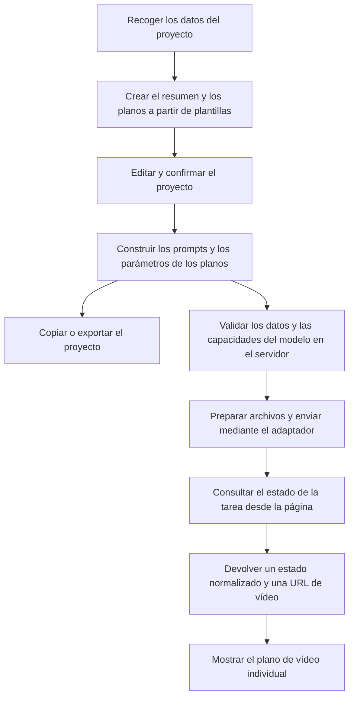

# AI Rap Video Generator — De la idea creativa al flujo de generación de vídeo

[English](README.md) · [简体中文](README.zh-CN.md) · [Deutsch](README.de.md) · [Français](README.fr.md) · **Español**

## Descripción general

**Un proyecto de referencia para desarrollar generadores de vídeos de rap con IA, que abarca la planificación de planos, la creación de prompts y la integración de una API de vídeo.**

Desarrollado con **TypeScript, Next.js y CSS Modules**, el repositorio incluye una interfaz de creación interactiva, planificación de planos mediante plantillas, un generador de prompts, gestión de tareas de generación y exportación de proyectos. La conexión con la API de vídeo se concentra en un adaptador independiente que cada desarrollador implementa para el servicio elegido.

**Demo: [AI Rap Video Generator](https://getairapvideos.com/)**

La demo muestra la experiencia del producto. Este repositorio ofrece un ejemplo de implementación independiente.

### Para qué puedes utilizar este código

- **Entender cómo funciona una aplicación de vídeo con IA:** seguir los datos del usuario desde la planificación de planos hasta la creación del prompt y la solicitud de generación.
- **Crear tu propia aplicación:** partir de la interfaz y el flujo de trabajo existentes e implementar el adaptador para la API de vídeo que elijas.
- **Reutilizar módulos:** incorporar las plantillas de planos, el generador de prompts, la gestión de tareas o la lógica de exportación en otro proyecto.
- **Explorar otros formatos de vídeo:** adaptar las plantillas visuales, las secuencias de planos y los prompts a otros temas o estilos.

La planificación creativa utiliza plantillas y reglas, por lo que no requiere una API adicional de un modelo de lenguaje. Sin una API de vídeo, la aplicación permite editar planos, consultar prompts, previsualizar archivos locales y exportar proyectos. Una vez conectado el servicio, puede generar un clip de vídeo para cada plano.

## Ejemplo completo

El siguiente ejemplo de un vídeo de rap de 15 segundos muestra cómo circulan los datos por la aplicación.

### 1. Recoger los datos del proyecto

El usuario introduce un tema, una letra opcional y una descripción del intérprete; después elige el estilo visual, la relación de aspecto, la duración y la intensidad de la actuación. La interfaz guarda estos datos en una estructura `CreativeConfig`:

```ts
import type { CreativeConfig } from './src/lib/types';

const config: CreativeConfig = {
  theme: 'An independent rapper steps into the light in a parking garage on a rainy night, moving from being overlooked to finding their voice.',
  lyrics: 'From the underground into the light, tonight I let my voice take flight.',
  performer: 'One independent rapper, with a consistent face and hairstyle across all shots.',
  styleId: 'night-street',
  aspectRatio: '9:16',
  durationSeconds: 15,
  energy: 'confident',
};
```

El tema describe la intención creativa. Los demás campos definen los ajustes visuales y los tiempos que utilizan los módulos de planificación y generación.

### 2. Combinar la configuración visual y las plantillas de planos

[`templates.ts`](src/lib/templates.ts) define tres estilos visuales —calle bajo la lluvia, escenario minimalista y animación de cómic— junto con niveles de intensidad de la actuación. La plantilla de calle bajo la lluvia aporta estos elementos comunes:

| Elemento | Descripción |
| --- | --- |
| Vestuario | Chaqueta negra y cadena plateada |
| Lugar | Aparcamiento subterráneo de noche, con el suelo de hormigón mojado |
| Iluminación | Luz ambiental azul y fría, con una luz de contorno cálida |
| Estilo visual | Realismo cinematográfico, textura natural de la piel y separación clara del sujeto respecto al fondo |

[`planner.ts`](src/lib/planner.ts) combina estos elementos con los datos del usuario para crear un resumen creativo y selecciona plantillas de planos según la duración solicitada. Un proyecto de 15 segundos comienza con tres planos:

| Plano | Tiempo | Actuación | Encuadre y movimiento de cámara |
| --- | --- | --- | --- |
| Presentar al intérprete | 0–5 segundos | Levantar la cabeza desde las sombras y mirar a cámara | Encuadre frontal estable desde la cintura |
| Comenzar la actuación | 5–10 segundos | Actuar frente a cámara con gestos naturales y seguros | Acercamiento lento desde un encuadre de cintura hasta uno de pecho |
| Mantener el plano final | 10–15 segundos | Entrar en una zona más iluminada y mantener la mirada hacia la cámara | Encuadre estable desde el pecho |

La selección sigue reglas predefinidas. El tema y la letra permanecen como contexto creativo; el planificador no utiliza análisis semántico para inventar una historia. Los proyectos de 30 y 45 segundos comienzan con seis y nueve planos, respectivamente.

### 3. Editar el proyecto y construir las solicitudes

El frontend permite modificar el resumen creativo y la acción, las indicaciones de cámara y la duración de cada plano. Un cambio en la configuración común actualiza todos los prompts; un cambio en la acción de un plano solo afecta a ese plano. La línea de tiempo y la duración total se recalculan a partir de los datos de los planos.

[`prompt-builder.ts`](src/lib/prompt-builder.ts) produce entonces dos salidas:

- **Un prompt de texto:** describe al intérprete y especifica el entorno, la acción y el estilo visual que debe generar el modelo.
- **Una solicitud estructurada:** transmite la relación de aspecto, la duración, los indicadores que especifican qué referencias multimedia utilizar y el punto de inicio del audio al adaptador de vídeo.

Este flujo conecta la interfaz creativa con el servicio de vídeo. Las plantillas, los prompts y la integración del proveedor se mantienen separados para poder modificarlos de forma independiente.

## Diseño de prompts

### Separar la configuración común de las indicaciones de cada plano

Un prompt es la instrucción de texto que se envía al modelo. Este proyecto lo construye a partir de las siguientes secciones:

| Sección | Origen | Propósito |
| --- | --- | --- |
| Contexto creativo | Tema y dirección emocional | Explicar lo que debe expresar el vídeo |
| Personaje, vestuario, entorno e iluminación | Resumen creativo | Definir los requisitos visuales comunes a los planos |
| Actuación y cámara | Plano actual y nivel de intensidad | Especificar lo que ocurre en ese plano |
| Contexto de la letra | Letra proporcionada por el usuario | Conservar el texto original como referencia creativa |
| Referencias multimedia | Archivos seleccionados y capacidades del modelo | Incluir instrucciones de retrato o audio cuando corresponda |
| Restricciones | Reglas comunes | Solicitar una toma continua, sin intérpretes adicionales ni subtítulos |

Esta estructura facilita ajustar la dirección visual general o revisar un plano concreto. Las instrucciones describen el resultado deseado; la consistencia de la apariencia del personaje y la calidad de la sincronización labial siguen dependiendo del modelo elegido.

<details>
<summary>Ver un prompt completo para el plano de actuación, con un retrato de referencia (en inglés)</summary>

```text
Create one continuous shot for a rap music video.

CREATIVE CONTEXT
An independent rapper finds the confidence to be heard.
Emotional direction: from restraint to confidence.

CHARACTER
One independent rapper, with a consistent face and hairstyle.
Use the supplied portrait as the identity reference.
Preserve the facial features and hairstyle.
Wardrobe: black jacket and a simple silver chain.

SETTING
An underground parking garage at night, with wet concrete
and open space around the performer.

LIGHTING
Cool blue overhead light with a subtle warm rim light.

PERFORMANCE
Face the camera with natural upper-body gestures.
Keep the face clearly visible and maintain confident eye contact.

CAMERA
Slowly push from a waist-up framing to a chest-up framing
in one continuous movement.

VISUAL STYLE
Cinematic realism, natural skin texture, restrained contrast
and clear subject separation.

CONSTRAINTS
One continuous shot. No additional performers.
No outfit changes. No captions, logos or watermarks.
```

</details>

### Transmitir tiempos y archivos mediante los parámetros del modelo

La relación de aspecto, la duración objetivo y el punto de inicio del audio se transmiten mediante `ShotRequest`; el texto del prompt no sustituye a los parámetros de la API. Si no hay retrato, se utiliza una descripción textual. Las instrucciones de referencia de audio solo se añaden cuando el usuario proporciona un archivo y el adaptador configurado indica que el modelo admite una actuación guiada por audio.

Los retratos y el audio se previsualizan localmente en el navegador. Cuando el usuario envía una solicitud de generación, el adaptador del servidor prepara los archivos. El punto de inicio del audio equivale al inicio elegido por el usuario más el desplazamiento del plano en la línea de tiempo. El adaptador debe recortar el fragmento de audio o convertir estos tiempos a los parámetros del proveedor.

[`export.ts`](src/lib/export.ts) exporta el resumen creativo, los planos y los prompts como Markdown, o el proyecto y los datos internos de las solicitudes como JSON. Las exportaciones incluyen los nombres de los archivos multimedia, pero no los archivos en sí.

## Flujo de generación

El frontend recoge y muestra los datos creativos; el servidor se comunica con el proveedor de vídeo. Separar la planificación de la generación permite cambiar de proveedor sin reescribir el editor de planos.



### Gestionar la generación por plano

Cada plano registra su identificador de solicitud, huella de configuración, estado de la tarea y resultado. La aplicación procesa una tarea de generación a la vez y bloquea los ajustes creativos mientras está activa, para mantener la correspondencia entre la configuración enviada y el resultado.

La huella de configuración identifica la versión a la que pertenece un resultado. Si el usuario edita un plano ya completado, la interfaz marca el vídeo anterior como un resultado de una versión previa y permite generar uno nuevo.

### Distinguir los fallos de generación de los problemas de red

| Situación | Comportamiento del flujo |
| --- | --- |
| El proveedor rechaza explícitamente una solicitud o informa de un fallo de generación | Permitir un nuevo intento para ese plano |
| Un envío no devuelve un resultado definitivo | Conservar el identificador y buscar la tarea existente sin volver a enviarla automáticamente |
| Una consulta de estado falla temporalmente | Mantener el último estado conocido y continuar consultando |
| La generación termina correctamente | Mostrar la URL de vídeo devuelta |

Esta distinción evita asumir que la generación ha fallado solo porque se ha agotado el tiempo de espera y enviar la misma solicitud dos veces. Para encontrar una tarea después de perder la respuesta de envío, el adaptador debe utilizar la búsqueda del proveedor o guardar una correspondencia entre identificadores de solicitud y de tarea.

Los borradores de texto se guardan en el almacenamiento local del navegador; los archivos y el estado de las tareas permanecen en la sesión actual de la página. El proyecto no incluye base de datos, cola de tareas en segundo plano, montaje de vídeo ni mezcla de audio. Estas funciones pueden añadirse mediante módulos de persistencia de tareas y posproducción multimedia.

## Arquitectura e integración de la API

### Ejecutar en local

Utiliza Node.js 22 o posterior. Desde el directorio del proyecto, ejecuta:

```bash
npm install
cp .env.example .env.local
npm run dev
```

Abre el [espacio de trabajo local](http://localhost:3000). En Windows puedes copiar `.env.example` a `.env.local` manualmente. Si dejas vacías las variables de entorno, la generación de vídeo permanecerá desactivada y las herramientas creativas seguirán disponibles.

### Guía del código fuente

| Módulo | Archivo | Responsabilidad |
| --- | --- | --- |
| Interfaz creativa | [studio.tsx](src/components/studio.tsx) | Conectar los datos del usuario, los editores, los prompts y los resultados de vídeo |
| Tipos de datos | [types.ts](src/lib/types.ts) | Definir las configuraciones creativas, los planos, las solicitudes y las tareas |
| Plantillas y planificación | [templates.ts](src/lib/templates.ts), [planner.ts](src/lib/planner.ts) | Construir el resumen creativo y la secuencia de planos |
| Generador de prompts | [prompt-builder.ts](src/lib/prompt-builder.ts) | Combinar instrucciones y crear los parámetros internos de las solicitudes |
| Tareas de generación | [workflow.ts](src/lib/workflow.ts), [use-video-workflow.ts](src/components/use-video-workflow.ts) | Enviar, consultar, recuperar y gestionar el estado de las tareas en el frontend |
| Adaptador de vídeo | [custom.ts](src/lib/providers/custom.ts) | Definir los métodos que deben implementarse para el proveedor elegido |
| Endpoint del servidor | [jobs/route.ts](src/app/api/video/jobs/route.ts) | Validar las entradas, invocar el adaptador y normalizar las respuestas |
| Exportación | [export.ts](src/lib/export.ts) | Crear archivos Markdown y JSON |

### Conectar tu propia API de vídeo

El código específico del proveedor se encuentra en `src/lib/providers/custom.ts`. Implementa estos cuatro métodos:

| Método | Responsabilidad del adaptador |
| --- | --- |
| `prepareAssets` | Subir retratos o audio y devolver referencias accesibles para el proveedor |
| `submitJob` | Convertir los parámetros del plano en una solicitud del proveedor y devolver una tarea de generación |
| `getJob` | Consultar la tarea y normalizar su estado y URL de vídeo |
| `findJobByRequestId` | Recuperar una tarea cuya respuesta de envío se haya perdido |

Configura la URL del servicio, la clave API y el nombre del modelo en `.env.local`, y declara las relaciones de aspecto, duraciones y capacidades multimedia admitidas. Tras implementar el adaptador, establece `ADAPTER_IMPLEMENTED` en `true` y reinicia la aplicación.

Las claves API se leen únicamente en el servidor. Los proveedores utilizan distintos formatos de solicitud y respuesta, por lo que conectar un modelo requiere código de adaptación además de una clave API.

Consulta la [guía de integración de la API (en inglés)](docs/api-integration.md) para conocer la especificación de los parámetros, el tratamiento de archivos y la recuperación de errores.
