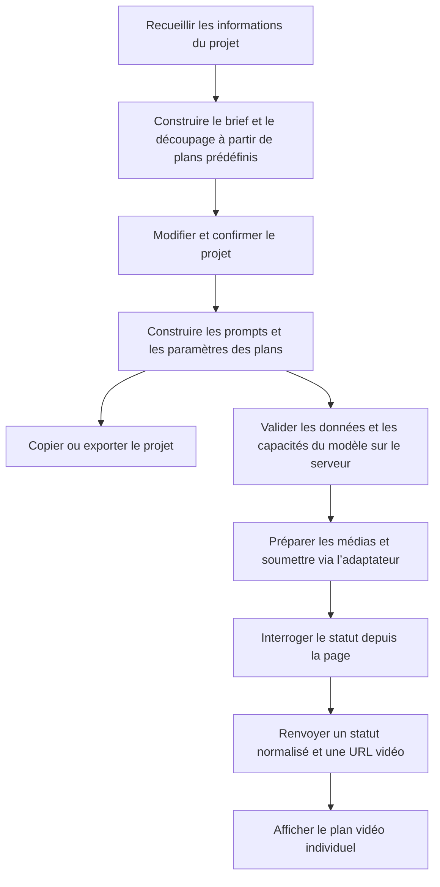

# AI Rap Video Generator — De l’idée créative au workflow de génération vidéo

[English](README.md) · [简体中文](README.zh-CN.md) · [Deutsch](README.de.md) · **Français** · [Español](README.es.md)

## Présentation

**Un projet de référence pour développer des générateurs de clips de rap par IA, du découpage en plans à la construction des prompts et à l’intégration d’une API vidéo.**

Développé avec **TypeScript, Next.js et CSS Modules**, ce dépôt comprend une interface de création interactive, un découpage à partir de plans prédéfinis, un générateur de prompts, la gestion des tâches de génération et l’export des projets. La connexion à l’API vidéo passe par un adaptateur distinct, à implémenter pour le service choisi.

**Démo : [AI Rap Video Generator](https://getairapvideos.com/)**

La démo présente l’expérience produit. Ce dépôt propose un exemple d’implémentation distinct.

### À quoi peut servir ce code

- **Comprendre le fonctionnement d’une application de vidéo par IA :** suivre les données saisies depuis le découpage en plans jusqu’à la construction du prompt et à la requête de génération.
- **Créer votre propre application :** partir de l’interface et du workflow existants, puis implémenter l’adaptateur de l’API vidéo choisie.
- **Réutiliser des modules :** intégrer les plans prédéfinis, la construction des prompts, la gestion des tâches ou la logique d’export dans un autre projet.
- **Explorer d’autres formats vidéo :** adapter les styles visuels, les séquences de plans et les prompts à d’autres sujets ou ambiances.

La préparation créative repose sur des modèles prédéfinis et des règles ; elle ne nécessite donc pas d’API de modèle de langage supplémentaire. Sans API vidéo, l’interface permet de modifier les plans, de consulter les prompts, de prévisualiser les médias locaux et d’exporter le projet. Une fois le service connecté, elle peut générer une séquence vidéo pour chaque plan.

## Exemple de bout en bout

L’exemple suivant, un clip de rap de 15 secondes, illustre la circulation des données dans l’application.

### 1. Recueillir les informations du projet

L’utilisateur renseigne un thème, des paroles facultatives et une description de l’interprète, puis choisit le style visuel, le format d’image, la durée et l’intensité de la performance. L’interface enregistre ces informations dans une structure `CreativeConfig` :

```ts
import type { CreativeConfig } from './src/lib/types';

const config: CreativeConfig = {
  theme: 'An independent rapper steps into the light in a parking garage on a rainy night, moving from being overlooked to finding their voice.',
  lyrics: 'From the underground into the light, tonight I let my voice take flight.',
  performer: 'One independent rapper, with a consistent face and hairstyle across all shots.',
  styleId: 'night-street',
  aspectRatio: '9:16',
  durationSeconds: 15,
  energy: 'confident',
};
```

Le thème décrit l’intention créative. Les autres champs définissent les choix visuels et les durées utilisés par les modules de découpage et de génération.

### 2. Combiner les choix visuels et les plans prédéfinis

[`templates.ts`](src/lib/templates.ts) définit trois styles visuels — rue sous la pluie, scène minimaliste et animation de style bande dessinée — ainsi que plusieurs niveaux d’intensité de la performance. Le style de rue sous la pluie fournit les éléments communs suivants :

| Élément | Direction |
| --- | --- |
| Tenue | Veste noire et chaîne argentée |
| Lieu | Parking souterrain de nuit, avec un sol en béton mouillé |
| Éclairage | Lumière ambiante bleue et froide, avec un contre-jour chaud |
| Style visuel | Réalisme cinématographique, texture de peau naturelle et sujet bien détaché de l’arrière-plan |

[`planner.ts`](src/lib/planner.ts) associe ces éléments aux informations de l’utilisateur pour constituer un brief créatif, puis sélectionne des plans prédéfinis selon la durée demandée. Un projet de 15 secondes commence par trois plans :

| Plan | Temps | Performance | Cadrage et mouvement de caméra |
| --- | --- | --- | --- |
| Présenter l’interprète | 0–5 secondes | Relever la tête depuis l’ombre et regarder la caméra | Cadrage frontal stable à partir de la taille |
| Commencer la performance | 5–10 secondes | Faire face à la caméra avec des gestes naturels et assurés | Rapprochement lent d’un cadrage à la taille vers un cadrage à la poitrine |
| Tenir le plan final | 10–15 secondes | Entrer dans une zone plus éclairée et garder le regard vers la caméra | Cadrage stable à partir de la poitrine |

La sélection des plans suit des règles prédéfinies. Le thème et les paroles restent un contexte créatif ; le module de découpage n’invente pas de scénario par analyse sémantique. Les projets de 30 et 45 secondes commencent respectivement avec six et neuf plans.

### 3. Modifier le projet et construire les requêtes

Le frontend permet de modifier le brief créatif ainsi que l’action, les indications de caméra et la durée de chaque plan. Un changement de paramètre commun actualise tous les prompts ; une modification de l’action d’un plan ne concerne que celui-ci. La chronologie et la durée totale sont recalculées à partir des données des plans.

[`prompt-builder.ts`](src/lib/prompt-builder.ts) produit ensuite deux sorties :

- **Un prompt textuel :** il décrit l’interprète, le décor, l’action et le style visuel au modèle.
- **Une requête structurée :** elle transmet le format d’image, la durée, les indicateurs précisant quelles références médias utiliser et le point de départ audio à l’adaptateur vidéo.

Ce flux relie l’interface créative au service vidéo. Les plans prédéfinis, les prompts et l’intégration du fournisseur restent séparés et peuvent être modifiés indépendamment.

## Conception des prompts

### Séparer les paramètres communs des consignes propres à chaque plan

Un prompt est l’instruction textuelle envoyée au modèle. Ce projet le construit à partir des sections suivantes :

| Section | Source | Rôle |
| --- | --- | --- |
| Contexte créatif | Thème et orientation émotionnelle | Expliquer ce que la vidéo doit exprimer |
| Personnage, tenue, décor et éclairage | Brief créatif | Définir les exigences visuelles communes aux plans |
| Performance et caméra | Plan courant et niveau d’intensité | Préciser ce qui se passe dans ce plan |
| Contexte des paroles | Paroles saisies par l’utilisateur | Conserver le texte original comme référence créative |
| Références médias | Fichiers sélectionnés et capacités du modèle | Ajouter les consignes relatives au portrait ou à l’audio lorsque cela s’applique |
| Contraintes | Règles communes | Demander une prise continue, sans interprète supplémentaire ni sous-titres |

Cette structure facilite l’ajustement de la direction visuelle générale ou d’un plan précis. Les consignes décrivent le résultat souhaité ; la constance de l’apparence du personnage et la qualité de la synchronisation labiale dépendent toujours du modèle choisi.

<details>
<summary>Voir un prompt complet pour le plan de performance, avec un portrait de référence (en anglais)</summary>

```text
Create one continuous shot for a rap music video.

CREATIVE CONTEXT
An independent rapper finds the confidence to be heard.
Emotional direction: from restraint to confidence.

CHARACTER
One independent rapper, with a consistent face and hairstyle.
Use the supplied portrait as the identity reference.
Preserve the facial features and hairstyle.
Wardrobe: black jacket and a simple silver chain.

SETTING
An underground parking garage at night, with wet concrete
and open space around the performer.

LIGHTING
Cool blue overhead light with a subtle warm rim light.

PERFORMANCE
Face the camera with natural upper-body gestures.
Keep the face clearly visible and maintain confident eye contact.

CAMERA
Slowly push from a waist-up framing to a chest-up framing
in one continuous movement.

VISUAL STYLE
Cinematic realism, natural skin texture, restrained contrast
and clear subject separation.

CONSTRAINTS
One continuous shot. No additional performers.
No outfit changes. No captions, logos or watermarks.
```

</details>

### Transmettre la durée et les médias via les paramètres du modèle

Le format d’image, la durée cible et le point de départ audio passent par `ShotRequest` ; le texte du prompt ne remplace pas les paramètres de l’API. En l’absence de portrait, le prompt utilise une description textuelle. Les consignes liées à l’audio ne sont ajoutées que si l’utilisateur fournit un fichier audio et si l’adaptateur configuré indique que le modèle prend en charge une performance pilotée par l’audio.

Les portraits et les fichiers audio sont prévisualisés localement dans le navigateur. Lorsque l’utilisateur envoie une demande de génération, l’adaptateur côté serveur prépare les médias. Le point de départ audio correspond au point choisi par l’utilisateur, augmenté du décalage du plan dans la chronologie. L’adaptateur doit découper l’extrait audio ou traduire ces indications dans les paramètres temporels du fournisseur.

[`export.ts`](src/lib/export.ts) exporte le brief, les plans et les prompts en Markdown, ou le projet et les données internes des requêtes en JSON. Les exports contiennent les noms des fichiers médias, mais pas les fichiers eux-mêmes.

## Workflow de génération

Le frontend recueille et affiche les données créatives ; le serveur communique avec le fournisseur vidéo. La séparation entre préparation et génération permet de changer de fournisseur sans réécrire l’éditeur de plans.



### Gérer la génération plan par plan

Chaque plan conserve son identifiant de requête, son empreinte de configuration, son statut et son résultat. L’interface traite une seule tâche de génération à la fois et verrouille les paramètres créatifs tant qu’elle est active, afin de conserver le lien entre la configuration envoyée et son résultat.

L’empreinte de configuration identifie la version associée à un résultat. Si l’utilisateur modifie un plan déjà généré, l’interface signale que la vidéo précédente correspond à une ancienne version et autorise une nouvelle génération.

### Distinguer les échecs de génération des problèmes réseau

| Situation | Comportement du workflow |
| --- | --- |
| Le fournisseur refuse explicitement une requête ou signale un échec de génération | Autoriser une nouvelle tentative pour ce plan |
| L’envoi ne renvoie aucun résultat définitif | Conserver l’identifiant de requête et rechercher la tâche existante, sans la soumettre automatiquement une seconde fois |
| Une requête de statut échoue temporairement | Conserver le dernier statut connu et poursuivre les vérifications |
| La génération réussit | Afficher l’URL vidéo renvoyée |

Cette distinction évite de considérer un délai d’attente dépassé comme une preuve d’échec et d’envoyer la même requête deux fois. Pour retrouver une tâche après la perte de la réponse, l’adaptateur doit utiliser la recherche du fournisseur ou enregistrer une correspondance entre les identifiants de requête et de tâche.

Les brouillons textuels utilisent le stockage local du navigateur ; les médias et l’état des tâches restent dans la session courante de la page. Le projet ne comprend ni base de données, ni file de tâches en arrière-plan, ni assemblage vidéo, ni mixage audio. Ces fonctions peuvent être ajoutées via des modules de persistance et de postproduction.

## Architecture et intégration API

### Exécuter le projet localement

Utiliser Node.js 22 ou une version ultérieure. Depuis le répertoire du projet, exécuter :

```bash
npm install
cp .env.example .env.local
npm run dev
```

Ouvrir l’[espace de travail local](http://localhost:3000). Sous Windows, il est possible de copier manuellement `.env.example` vers `.env.local`. Si les variables restent vides, la génération vidéo est désactivée, mais les outils créatifs restent disponibles.

### Repères dans le code source

| Module | Fichier | Responsabilité |
| --- | --- | --- |
| Interface créative | [studio.tsx](src/components/studio.tsx) | Relier les saisies, les éditeurs, les prompts et les résultats vidéo |
| Types de données | [types.ts](src/lib/types.ts) | Définir les configurations créatives, plans, requêtes et tâches |
| Préréglages et découpage | [templates.ts](src/lib/templates.ts), [planner.ts](src/lib/planner.ts) | Construire le brief et la séquence de plans |
| Construction des prompts | [prompt-builder.ts](src/lib/prompt-builder.ts) | Combiner les consignes et créer les paramètres internes des requêtes |
| Tâches de génération | [workflow.ts](src/lib/workflow.ts), [use-video-workflow.ts](src/components/use-video-workflow.ts) | Soumettre, interroger, récupérer et gérer l’état des tâches côté frontend |
| Adaptateur vidéo | [custom.ts](src/lib/providers/custom.ts) | Définir les méthodes à implémenter pour le fournisseur choisi |
| Point d’entrée serveur | [jobs/route.ts](src/app/api/video/jobs/route.ts) | Valider les entrées, appeler l’adaptateur et normaliser les réponses |
| Export | [export.ts](src/lib/export.ts) | Produire les fichiers Markdown et JSON |

### Connecter votre propre API vidéo

Le code propre au fournisseur se place dans `src/lib/providers/custom.ts`. Quatre méthodes sont à implémenter :

| Méthode | Responsabilité de l’adaptateur |
| --- | --- |
| `prepareAssets` | Téléverser les portraits ou l’audio et renvoyer des références accessibles au fournisseur |
| `submitJob` | Convertir les paramètres du plan au format de requête du fournisseur et renvoyer une tâche de génération |
| `getJob` | Interroger la tâche et normaliser son statut et son URL vidéo |
| `findJobByRequestId` | Retrouver une tâche lorsque la réponse à sa soumission a été perdue |

Renseigner l’URL du service, la clé API et le nom du modèle dans `.env.local`, puis déclarer les formats d’image et les durées acceptés, ainsi que la prise en charge des références visuelles et audio. Une fois l’adaptateur implémenté, passer `ADAPTER_IMPLEMENTED` à `true` et redémarrer l’application.

Les clés API sont lues uniquement côté serveur. Les fournisseurs utilisent des formats de requête et de réponse différents ; leur connexion nécessite donc du code d’adaptation en plus d’une clé API.

La spécification des paramètres, la gestion des médias et la récupération après erreur sont détaillées dans le [guide d’intégration API (en anglais)](docs/api-integration.md).
