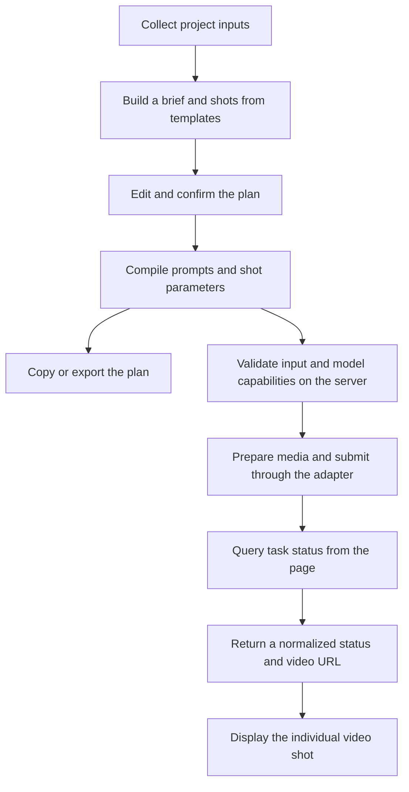

# AI Rap Video Generator — From Creative Ideas to Video Generation Workflows

**English** · [简体中文](README.zh-CN.md) · [Deutsch](README.de.md) · [Français](README.fr.md) · [Español](README.es.md)

## Overview

**A reference project for building AI rap video generators, covering shot planning, prompt construction, and video API integration.**

Built with **TypeScript, Next.js, and CSS Modules**, the repository includes an interactive workspace, template-based shot planning, a prompt builder, generation task management, and plan exports. Video API integration is isolated in a provider adapter that you implement for your chosen service.

**Demo: [AI Rap Video Generator](https://getairapvideos.com/)**

The demo shows the product experience. This repository provides a separate implementation example.

### What you can use this code for

- **Understand how an AI video application works:** trace user inputs through shot planning and prompt construction to a generation request.
- **Start your own application:** build on the creative interface and workflow, then implement the adapter for your chosen video API.
- **Reuse individual modules:** use the shot templates, prompt builder, task handling, or export logic in another project.
- **Explore other video formats:** adapt the visual templates, shot sequences, and prompts to a different subject or style.

Creative planning uses templates and rules, so it does not require an additional language model API. Without a video API, the workspace supports shot editing, prompt previews, local media previews, and plan exports. Once connected, it can generate a video clip for each shot.

## End-to-End Example

The following 15-second rap video example shows how data moves through the application.

### 1. Collect project inputs

The user provides a theme, optional lyrics, and a performer description, then chooses a visual style, aspect ratio, duration, and performance intensity. The interface stores these as a `CreativeConfig`:

```ts
import type { CreativeConfig } from './src/lib/types';

const config: CreativeConfig = {
  theme: 'An independent rapper steps into the light in a parking garage on a rainy night, moving from being overlooked to finding their voice.',
  lyrics: 'From the underground into the light, tonight I let my voice take flight.',
  performer: 'One independent rapper, with a consistent face and hairstyle across all shots.',
  styleId: 'night-street',
  aspectRatio: '9:16',
  durationSeconds: 15,
  energy: 'confident',
};
```

The theme describes the creative intent. The other fields provide the visual settings and timing used by the planning and generation modules.

### 2. Combine visual settings and shot templates

[`templates.ts`](src/lib/templates.ts) defines three visual styles—rainy streets, a minimalist stage, and comic-style animation—along with performance intensity settings. The rainy street template provides these shared settings:

| Setting | Description |
| --- | --- |
| Wardrobe | Black jacket and a silver chain |
| Location | An underground parking garage at night, with wet concrete |
| Lighting | Cool blue ambient light and a warm rim light |
| Visual style | Cinematic realism, natural skin texture, and clear subject separation |

[`planner.ts`](src/lib/planner.ts) combines these settings with the user input to create a creative brief, then selects shot templates based on the requested duration. A 15-second plan starts with three shots:

| Shot | Time | Performance | Framing and camera movement |
| --- | --- | --- | --- |
| Establish the performer | 0–5 seconds | Raise their head from the shadows and look toward the camera | A stable, frontal waist-up shot |
| Begin the performance | 5–10 seconds | Face the camera with natural, confident gestures | Slowly push from waist-up to chest-up framing |
| Hold the closing shot | 10–15 seconds | Step into a brighter area and hold eye contact | A stable chest-up composition |

Shot selection follows predefined rules. The theme and lyrics remain creative context; the planner does not use semantic analysis to invent a storyline. The 30- and 45-second plans start with six and nine shots respectively.

### 3. Edit the plan and build requests

The frontend lets users edit the creative brief and each shot's action, camera direction, and duration. Changing a shared setting updates every shot's prompt; changing one shot's action affects that shot only. The timeline and total duration are recalculated from the shot data.

[`prompt-builder.ts`](src/lib/prompt-builder.ts) then produces two outputs:

- **A text prompt:** describes the performer, setting, action, and visual style to the model.
- **A structured request:** carries the aspect ratio, duration, flags indicating which media references to use, and audio start time for the video adapter.

This flow connects the creative interface to the video service while keeping templates, prompts, and provider integration separate, so each can be changed independently.

## Prompt Design

### Separate shared settings from individual shot directions

A prompt is the text instruction sent to a model. This project builds it from the following sections:

| Section | Source | Purpose |
| --- | --- | --- |
| Creative context | Theme and emotional direction | Explain what the video should express |
| Character, wardrobe, setting, and lighting | Creative brief | Define visual requirements shared across shots |
| Performance and camera | Current shot and intensity setting | Specify what happens in this shot |
| Lyric context | User-provided lyrics | Preserve the original wording as creative context |
| Media references | Selected assets and model capabilities | Include portrait or audio instructions when applicable |
| Constraints | Shared rules | Request a continuous shot, no extra performers, and no captions |

This structure makes it easier to adjust the overall visual direction or revise an individual shot. These are creative instructions; identity consistency and lip-sync quality still depend on the selected model.

<details>
<summary>View a complete prompt for the performance shot, including a portrait reference</summary>

```text
Create one continuous shot for a rap music video.

CREATIVE CONTEXT
An independent rapper finds the confidence to be heard.
Emotional direction: from restraint to confidence.

CHARACTER
One independent rapper, with a consistent face and hairstyle.
Use the supplied portrait as the identity reference.
Preserve the facial features and hairstyle.
Wardrobe: black jacket and a simple silver chain.

SETTING
An underground parking garage at night, with wet concrete
and open space around the performer.

LIGHTING
Cool blue overhead light with a subtle warm rim light.

PERFORMANCE
Face the camera with natural upper-body gestures.
Keep the face clearly visible and maintain confident eye contact.

CAMERA
Slowly push from a waist-up framing to a chest-up framing
in one continuous movement.

VISUAL STYLE
Cinematic realism, natural skin texture, restrained contrast
and clear subject separation.

CONSTRAINTS
One continuous shot. No additional performers.
No outfit changes. No captions, logos or watermarks.
```

</details>

### Pass timing and media through model parameters

Aspect ratio, target duration, and audio start time are passed through `ShotRequest`; prompt text does not replace API parameters. Without a portrait, the prompt uses a text description. Audio-reference instructions are added only when the user provides audio and the configured adapter declares that the model supports audio-driven performance.

Portraits and audio are previewed locally in the browser. When the user submits a generation request, the server-side adapter prepares the media. The audio start time is the user's selected start point plus the current shot's timeline offset. The adapter must trim the audio segment or map these times to the provider's parameters.

[`export.ts`](src/lib/export.ts) exports the brief, shots, and prompts as Markdown, or the plan and internal request data as JSON. Exports include media filenames, not the media files themselves.

## Generation Workflow

The frontend collects and displays creative data; the server communicates with the video provider. Keeping creative planning separate from generation lets developers change providers without rewriting the shot editor.



### Manage generation per shot

Each shot tracks its request ID, configuration fingerprint, task status, and result. The workspace processes one generation task at a time and locks creative settings while it is active, keeping the submitted configuration associated with its result.

The configuration fingerprint identifies which version a result belongs to. If the user edits a completed shot, the interface marks its previous video as an older result and allows another generation.

### Distinguish failed tasks from network problems

| Situation | Workflow behavior |
| --- | --- |
| The provider explicitly rejects a request or reports a failed generation | Allow a retry for that shot |
| A submission returns no definitive result | Keep the request ID and look up the task without automatically resubmitting it |
| A status query temporarily fails | Preserve the last known status and continue querying |
| Generation succeeds | Display the returned video URL |

This distinction prevents a timeout from being treated as proof of failure, which could lead to a duplicate request. To find a task after its submission response is lost, the adapter must use provider lookup support or store a mapping between request IDs and task IDs.

Text drafts use browser local storage; media and task state remain in the current page session. The project does not include a database, background task queue, video assembly, or audio mixing. Add task persistence and media post-processing modules if your application needs them.

## Architecture & API Integration

### Run locally

Use Node.js 22 or later. From the project directory, run:

```bash
npm install
cp .env.example .env.local
npm run dev
```

Open the [local workspace](http://localhost:3000). On Windows, you can copy `.env.example` to `.env.local` manually. Leaving the environment values empty keeps video generation disabled while the creative tools remain available.

### Source Code Guide

| Module | File | Responsibility |
| --- | --- | --- |
| Creative interface | [studio.tsx](src/components/studio.tsx) | Connect inputs, editors, prompts, and video results |
| Data types | [types.ts](src/lib/types.ts) | Define creative configurations, shots, requests, and tasks |
| Templates and planning | [templates.ts](src/lib/templates.ts), [planner.ts](src/lib/planner.ts) | Build the creative brief and shot sequence |
| Prompt builder | [prompt-builder.ts](src/lib/prompt-builder.ts) | Combine instructions and create internal request parameters |
| Generation tasks | [workflow.ts](src/lib/workflow.ts), [use-video-workflow.ts](src/components/use-video-workflow.ts) | Submit, query, recover, and manage frontend task state |
| Video adapter | [custom.ts](src/lib/providers/custom.ts) | Define the methods to implement for your chosen provider |
| Server endpoint | [jobs/route.ts](src/app/api/video/jobs/route.ts) | Validate inputs, invoke the adapter, and normalize responses |
| Plan export | [export.ts](src/lib/export.ts) | Produce Markdown and JSON files |

### Connect your own video API

Provider-specific code belongs in `src/lib/providers/custom.ts`. Implement these four methods:

| Method | Adapter responsibility |
| --- | --- |
| `prepareAssets` | Upload portraits or audio and return provider-accessible references |
| `submitJob` | Map shot parameters to a provider request and return a generation task |
| `getJob` | Query the task and normalize its status and video URL |
| `findJobByRequestId` | Recover a task when its submission response was lost |

Set the service URL, API key, and model name in `.env.local`, then declare the model's supported aspect ratios, durations, and media capabilities. After implementing the adapter, set `ADAPTER_IMPLEMENTED` to `true` and restart the application.

API keys are read only on the server. Providers use different request and response formats, so connecting a model requires adapter code in addition to an API key.

See the [API Integration Guide](docs/api-integration.md) for parameter definitions, media handling, and error recovery.
