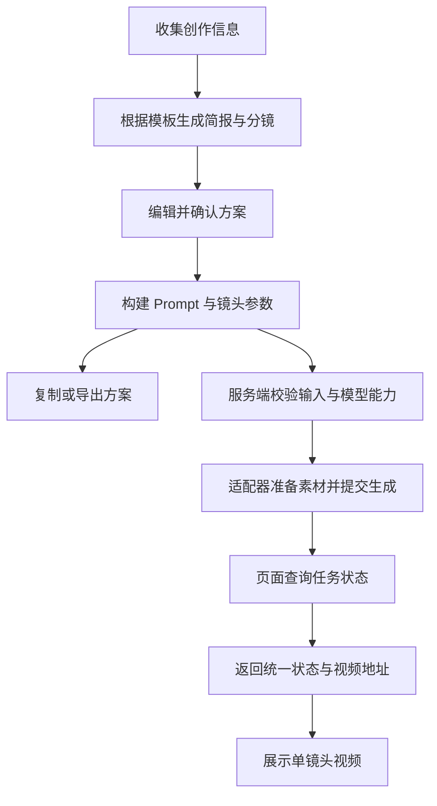

# AI Rap Video Generator — 从创作想法到视频生成工作流

[English](README.md) · **简体中文** · [Deutsch](README.de.md) · [Français](README.fr.md) · [Español](README.es.md)

## 项目简介

**一个用于开发 AI 说唱视频生成器的参考项目，涵盖分镜规划、Prompt 构建和视频 API 接入。**

项目使用 **TypeScript、Next.js 和 CSS Modules**，提供交互式创作界面、基于模板的分镜规划、Prompt 构建、生成任务管理和方案导出功能。视频服务接入集中在独立的适配器中，由开发者按照所选服务的接口要求实现。

**Demo：[AI Rap Video Generator](https://getairapvideos.com/)**

Demo 展示产品体验，本仓库提供独立的实现示例。

### 这份源码可以用来做什么

- **理解 AI 视频应用的实现方式**：从用户填写的信息出发，跟踪分镜规划、Prompt 构建和生成请求的完整过程。
- **作为自己的项目起点**：使用现有的创作界面和工作流，再实现所选视频 API 的适配器。
- **复用其中的模块**：在其他项目中使用分镜模板、Prompt 构建、任务处理或方案导出逻辑。
- **扩展其他视频场景**：调整视觉模板、镜头组合和生成指令，用于不同的主题或风格。

创意规划使用模板与规则，不需要额外的语言模型 API。未接入视频 API 时，可以编辑分镜、查看 Prompt、预览本地素材并导出方案；接入后，可以为每个镜头生成对应的视频片段。

## 完整创作示例

下面以一支 15 秒的说唱视频为例，说明数据如何在各个模块之间流转。

### 1. 收集创作信息

用户填写主题、可选歌词和人物描述，并选择视觉风格、画幅、时长与表演强度。界面将它们组织成一份 `CreativeConfig`：

```ts
import type { CreativeConfig } from './src/lib/types';

const config: CreativeConfig = {
  theme: 'An independent rapper steps into the light in a parking garage on a rainy night, moving from being overlooked to finding their voice.',
  lyrics: 'From the underground into the light, tonight I let my voice take flight.',
  performer: 'One independent rapper, with a consistent face and hairstyle across all shots.',
  styleId: 'night-street',
  aspectRatio: '9:16',
  durationSeconds: 15,
  energy: 'confident',
};
```

主题描述创作意图，其余字段提供分镜规划和视频生成所需的视觉设定与时间参数。

### 2. 组合视觉设定与分镜模板

[`templates.ts`](src/lib/templates.ts) 定义雨夜街头、极简舞台、漫画风格动画三套视觉风格，以及不同的表演强度。雨夜街头模板提供以下共同设定：

| 设定 | 内容 |
| --- | --- |
| 服装 | 黑色夹克、银色项链 |
| 场景 | 夜间地下停车场，潮湿的混凝土地面 |
| 光线 | 冷蓝色环境光与暖色轮廓光 |
| 视觉风格 | 电影写实、自然肤质、人物与背景层次分明 |

[`planner.ts`](src/lib/planner.ts) 将这些设定与用户输入组合成创意简报，再根据目标时长选择镜头模板。15 秒方案从三个镜头开始：

| 镜头 | 时间 | 人物动作 | 构图与相机运动 |
| --- | --- | --- | --- |
| 建立人物 | 0–5 秒 | 从阴影中抬头，看向镜头 | 稳定的正面半身构图 |
| 进入表演 | 5–10 秒 | 面向镜头，以自然、自信的手势表演 | 从半身缓慢推进至胸部以上 |
| 保持收尾画面 | 10–15 秒 | 进入较亮区域，持续直视镜头 | 稳定的胸部以上构图 |

分镜由预设规则选择。主题与歌词作为创作上下文保留，规划模块不通过语义分析自动编写剧情。30 秒和 45 秒方案分别从 6 个和 9 个镜头开始。

### 3. 编辑方案并生成请求

前端允许修改创意简报，以及每个镜头的动作、构图、相机运动和时长。修改共同设定会更新所有镜头的 Prompt；修改单个镜头的动作只影响该镜头。时间轴与总时长根据镜头数据重新计算。

[`prompt-builder.ts`](src/lib/prompt-builder.ts) 随后生成两类输出：

- **文字 Prompt**：向模型描述人物、场景、动作和视觉风格。
- **结构化请求**：包含画幅、时长、是否使用人物或音频参考的标记，以及音频起点，供视频适配器处理。

这条数据流程将创作界面与视频服务连接起来。模板、Prompt 和供应商接入各自独立，便于分别修改。

## Prompt 设计

### 将共同设定与单镜头指令分开

Prompt 是发送给模型的文字指令。本项目按以下结构组织：

| 部分 | 数据来源 | 作用 |
| --- | --- | --- |
| 创作背景 | 主题与情绪方向 | 说明视频的表达意图 |
| 人物、服装、场景与光线 | 创意简报 | 定义各镜头共用的视觉要求 |
| 表演与运镜 | 当前镜头与表演强度 | 明确这个镜头发生什么 |
| 歌词上下文 | 用户提供的歌词 | 保留原文作为创作参考 |
| 素材参考 | 已选素材与模型能力 | 按条件加入人物或音频参考指令 |
| 画面限制 | 共同约束 | 要求连续镜头、无额外人物和无字幕等 |

这种结构便于调整整支视频的视觉方向，也便于修改单个镜头。这些是创作要求，人物一致性和口型效果仍取决于实际模型能力。

<details>
<summary>查看完整的表演镜头 Prompt 示例（英文，含人物参考图）</summary>

```text
Create one continuous shot for a rap music video.

CREATIVE CONTEXT
An independent rapper finds the confidence to be heard.
Emotional direction: from restraint to confidence.

CHARACTER
One independent rapper, with a consistent face and hairstyle.
Use the supplied portrait as the identity reference.
Preserve the facial features and hairstyle.
Wardrobe: black jacket and a simple silver chain.

SETTING
An underground parking garage at night, with wet concrete
and open space around the performer.

LIGHTING
Cool blue overhead light with a subtle warm rim light.

PERFORMANCE
Face the camera with natural upper-body gestures.
Keep the face clearly visible and maintain confident eye contact.

CAMERA
Slowly push from a waist-up framing to a chest-up framing
in one continuous movement.

VISUAL STYLE
Cinematic realism, natural skin texture, restrained contrast
and clear subject separation.

CONSTRAINTS
One continuous shot. No additional performers.
No outfit changes. No captions, logos or watermarks.
```

</details>

### 通过模型参数传递时长和素材

画幅、目标时长与音频起点通过 `ShotRequest` 传递，Prompt 文字不能代替 API 参数。没有人物照片时使用文字描述；只有用户提供音频，且已配置的适配器声明模型支持音频驱动表演时，才加入音频参考指令。

人物照片与音频先在浏览器本地预览。用户提交生成请求后，服务端适配器负责准备素材。音频起点等于用户选择的起点加上当前镜头在时间轴中的偏移。适配器需要据此截取音频片段，或将这些时间值转换为供应商的参数。

[`export.ts`](src/lib/export.ts) 将简报、分镜和 Prompt 导出为 Markdown，或将方案与内部请求数据导出为 JSON。导出文件包含素材文件名，不包含媒体文件本身。

## 生成工作流

前端负责收集和展示创作数据，服务端负责与视频服务提供商通信。将创作规划与生成流程分开，就可以更换供应商，而无需重写分镜编辑器。



### 按镜头管理生成

每个镜头记录请求标识、配置指纹、任务状态和结果。工作台一次处理一个生成任务，并在处理期间锁定创作设置，确保提交的配置与结果保持对应。

配置指纹用于识别结果对应的版本。用户修改已完成的镜头后，界面将原视频标记为旧版本，并允许再次生成。

### 区分任务失败与网络异常

| 情况 | 工作流处理 |
| --- | --- |
| 供应商明确拒绝请求或报告生成失败 | 允许重试该镜头 |
| 提交未返回明确结果 | 保留请求标识，查询原任务，不自动重复提交 |
| 状态查询暂时失败 | 保留最后已知状态并继续查询 |
| 生成成功 | 展示返回的视频地址 |

这样可以避免将超时直接当作生成失败，进而重复提交请求。要在提交响应丢失后找回任务，适配器需要调用供应商的查询接口，或自行保存请求标识与任务标识的对应关系。

文字草稿保存在浏览器本地，素材与任务状态保留在当前页面会话。项目不包含数据库、后台任务队列、视频拼接或音频混音；需要这些功能时，可以扩展任务存储和媒体后处理模块。

## 架构与 API 接入

### 本地运行

使用 Node.js 22 或更新版本，在项目目录执行：

```bash
npm install
cp .env.example .env.local
npm run dev
```

打开 [本地工作台](http://localhost:3000)。Windows 下可以手动复制 `.env.example` 为 `.env.local`。环境变量保持为空时，视频生成处于未配置状态，其余创作工具仍可使用。

### 源码入口

| 模块 | 文件 | 职责 |
| --- | --- | --- |
| 创作界面 | [studio.tsx](src/components/studio.tsx) | 连接输入、编辑器、Prompt 与视频结果 |
| 数据类型 | [types.ts](src/lib/types.ts) | 定义创意配置、镜头、请求与任务 |
| 模板与规划 | [templates.ts](src/lib/templates.ts)、[planner.ts](src/lib/planner.ts) | 生成创意简报与镜头序列 |
| Prompt 构建 | [prompt-builder.ts](src/lib/prompt-builder.ts) | 组合指令并生成内部请求参数 |
| 生成任务 | [workflow.ts](src/lib/workflow.ts)、[use-video-workflow.ts](src/components/use-video-workflow.ts) | 提交、查询、恢复与前端任务状态管理 |
| 视频适配器 | [custom.ts](src/lib/providers/custom.ts) | 定义接入所选供应商时需要实现的方法 |
| 服务端入口 | [jobs/route.ts](src/app/api/video/jobs/route.ts) | 校验输入、调用适配器并统一响应格式 |
| 方案导出 | [export.ts](src/lib/export.ts) | 生成 Markdown 和 JSON 文件 |

### 接入自己的视频 API

供应商相关代码位于 `src/lib/providers/custom.ts`。需要实现四个方法：

| 方法 | 适配器职责 |
| --- | --- |
| `prepareAssets` | 上传人物照片或音频，返回供应商可访问的素材引用 |
| `submitJob` | 将镜头参数映射为供应商请求并返回生成任务 |
| `getJob` | 查询任务，将状态和视频地址转换为统一格式 |
| `findJobByRequestId` | 在提交响应丢失时找回原任务 |

在 `.env.local` 中填写服务地址、API 密钥和模型名称，再声明模型支持的画幅、时长与素材能力。完成适配器后，将 `ADAPTER_IMPLEMENTED` 设为 `true` 并重启应用。

API 密钥只由服务端读取。不同供应商的请求与响应格式不同，因此除了填写密钥，还需要实现适配代码。

参数说明、素材处理和错误恢复的详细步骤见 [API 接入指南（英文）](docs/api-integration.md)。
